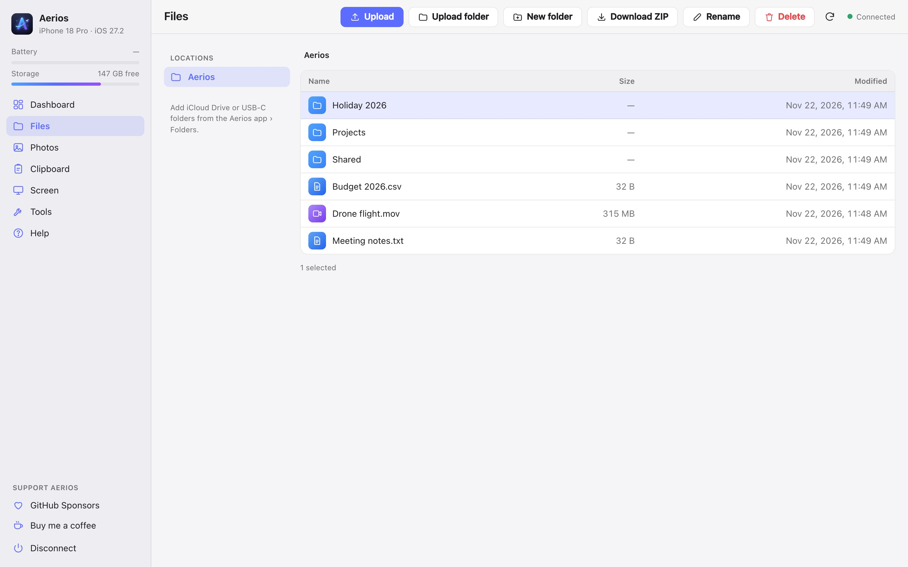
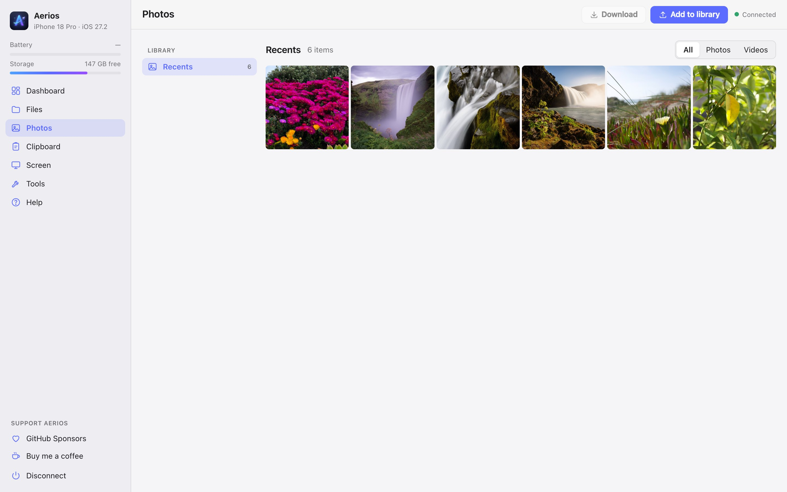
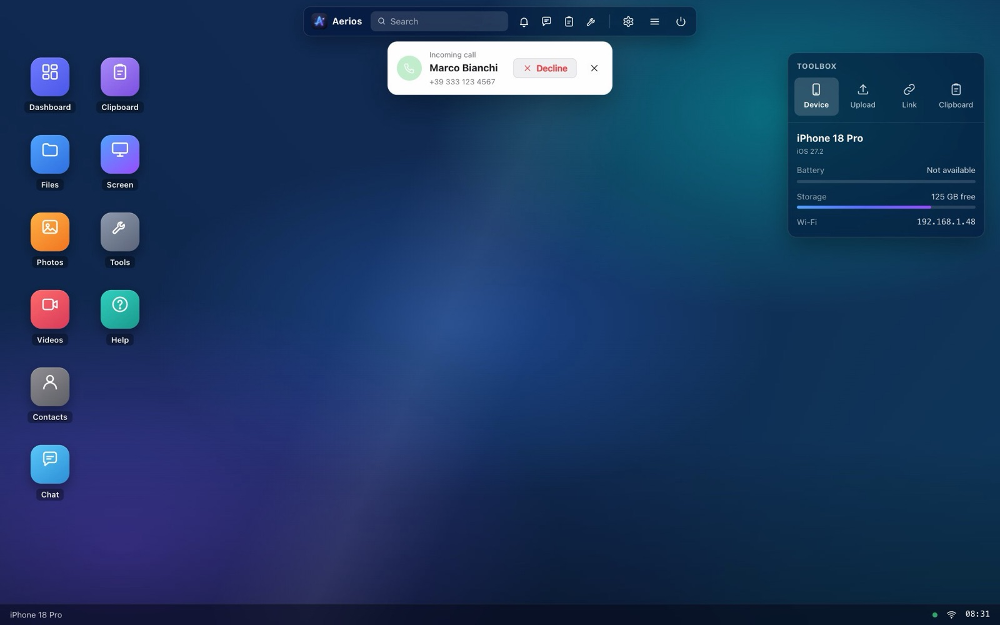
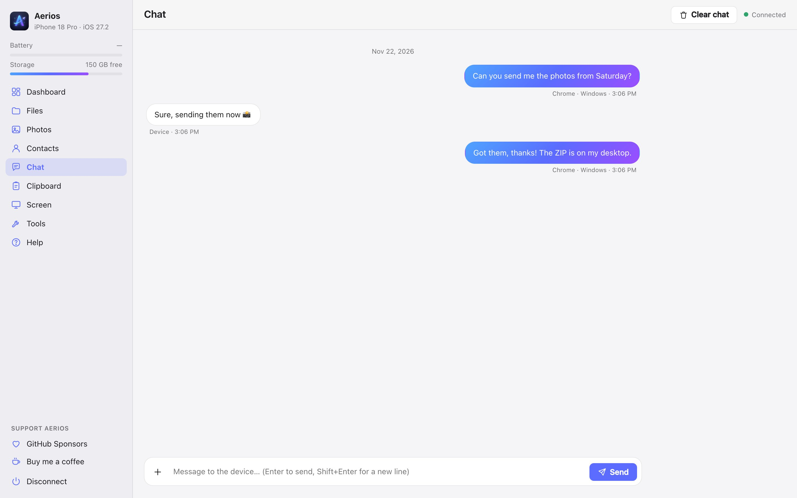
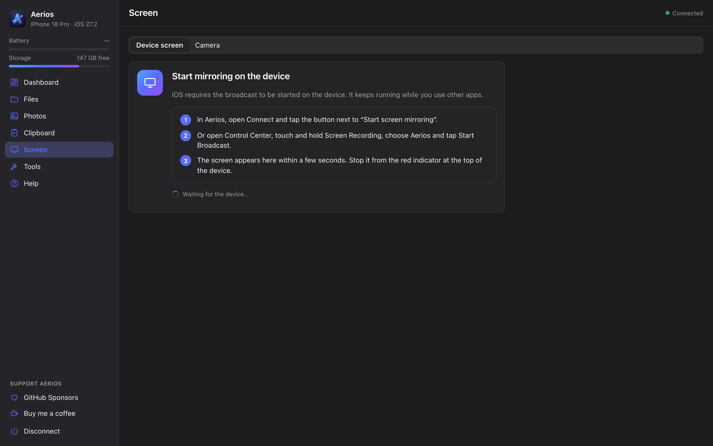
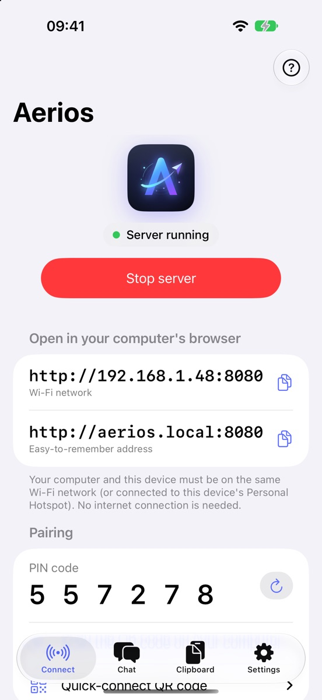
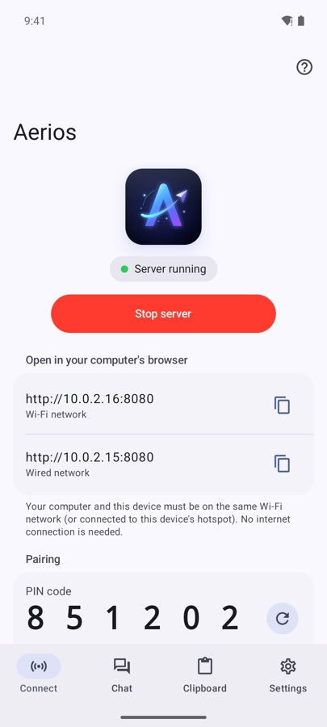
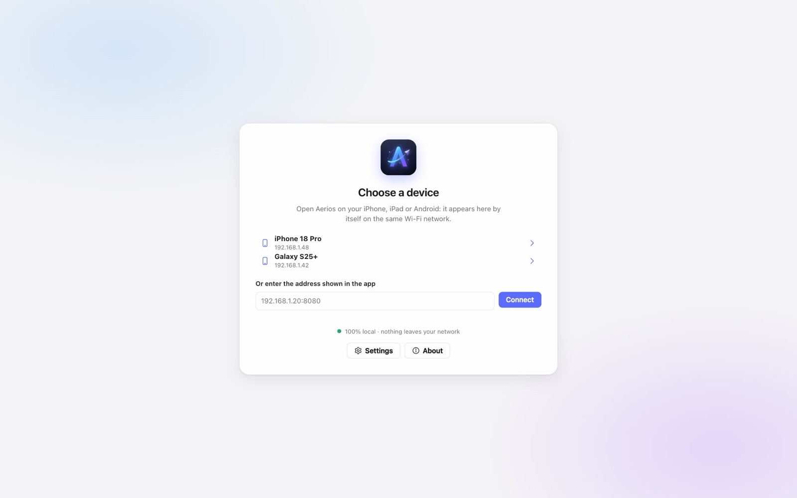
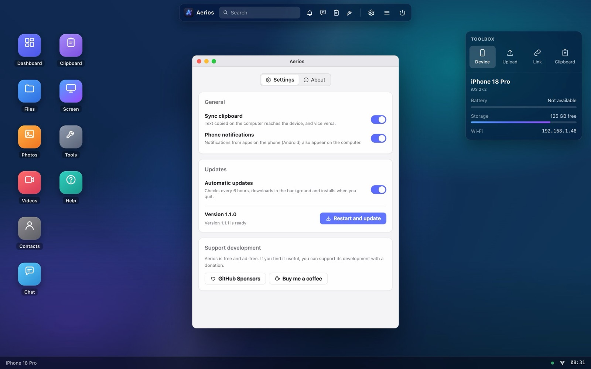

  

<h1 align="center">Aerios</h1>

  <b>Your phone on your computer, without cables, accounts or cloud.</b> 
  iPhone, iPad and Android · Mac, Windows and Linux · Free, no ads

  <a href="https://github.com/kikoz85/Aerios/releases/latest"><b>⬇ Download for Mac, Windows and Linux</b></a>
  &nbsp;·&nbsp; <a href="#italiano">Italiano</a>

## What you can do

- **Files** — move files between phone and computer: drag them in, download whole folders in one click.
- **Photos and videos** — browse your whole library on the big screen and save the originals, in full quality.
- **Music** — play your phone's songs on the computer, with cover art and a retro LED VU meter.
- **Chat and clipboard** — copy on the phone, paste on the computer (and the other way round); send yourself texts, links and files.
- **Calls and notifications** — see who is calling and get your phone's notifications on the computer (Android).
- **Screen and camera** — watch your phone's screen live, use its camera, take a screenshot in one click.
- **Find your phone** — make it ring loudly, even in silent mode.
- **Contacts and messages** — edit your contacts with a real keyboard; read and send SMS (Android).

| | |
|---|---|
|  |  |
| Files: drag and drop, folders, ZIP downloads | Your photo library, in original quality |
|  |  |
| Music with cover art and LED VU meter | Incoming call on your computer |
|  |  |
| Chat with your phone, with attachments | Your phone's screen, live |

## Get started in 3 steps

1. **Install Aerios on your phone or tablet** (iPhone, iPad or Android) and open it.
2. **Install Aerios on your computer** from the [download page](https://github.com/kikoz85/Aerios/releases/latest).
3. **Connect**: the computer finds the phone on your Wi-Fi by itself. Enter the PIN shown on the phone, confirm, done.

No computer app? Just type the address shown on the phone into any browser.

| | | |
|---|---|---|
|  |  |  |
| Aerios on iPhone | Aerios on Android | The computer finds your phone |

## Which file should I download?

| Your computer | Download |
|---|---|
| **Mac** (Apple Silicon or Intel) | the file ending in `macos.dmg`, then drag Aerios into Applications |
| **Windows** (most PCs) | the file ending in `x64-setup.exe` |
| **Windows on ARM** (e.g. Surface with Snapdragon) | the file ending in `arm64-setup.exe` |
| **Linux** (Ubuntu, Debian, Mint…) | the `.deb` file (`amd64` for most PCs, `arm64` for ARM computers) |
| **Linux** (Fedora, openSUSE…) | the `.rpm` file, or the `.AppImage` file for any distribution |

Aerios keeps itself up to date: when a new version is out it's downloaded in the background and installed the next
time you quit the app.

## Questions

**Is it safe? Does my data go online?** No. Phone and computer talk directly over your Wi-Fi: nothing passes through
the internet, there is no account and nothing is collected. Every new computer must be confirmed on the phone.

**Do I need the same Wi-Fi?** Yes, phone and computer must be on the same network. Away from home you can connect the
computer to your phone's hotspot.

**Why does iPhone show fewer features than Android?** Apple doesn't let apps read other apps' notifications, see who is
calling or stay active in the background. On iPhone you can start Aerios in a tap from Control Center, the Action
button or Siri.

**What does it cost?** Nothing. If Aerios is useful to you, you can support its development:
[GitHub Sponsors](https://github.com/sponsors/kikoz85) · [PayPal](https://www.paypal.com/donate/?hosted_button_id=B9PE789NMSURW)

---

<h1 align="center">Aerios · Italiano</h1>

  <b>Il tuo telefono sul computer, senza cavi, account o cloud.</b> 
  iPhone, iPad e Android · Mac, Windows e Linux · Gratis, senza pubblicità

<a href="https://github.com/kikoz85/Aerios/releases/latest"><b>⬇ Scarica per Mac, Windows e Linux</b></a>

## Cosa puoi fare

- **File** — sposta file tra telefono e computer: trascinali, scarica intere cartelle con un clic.
- **Foto e video** — sfoglia tutta la libreria sullo schermo grande e salva gli originali, in qualità piena.
- **Musica** — ascolta sul computer le canzoni del telefono, con copertina e VU meter LED in stile retrò.
- **Chat e appunti** — copia sul telefono, incolla sul computer (e viceversa); mandati testi, link e file.
- **Chiamate e notifiche** — vedi chi ti chiama e ricevi le notifiche del telefono sul computer (Android).
- **Schermo e fotocamera** — guarda lo schermo del telefono dal vivo, usa la sua fotocamera, fai uno screenshot con un clic.
- **Trova il telefono** — fallo squillare forte, anche in silenzioso.
- **Contatti e messaggi** — modifica i contatti con una tastiera vera; leggi e invia SMS (Android).

| | |
|---|---|
|  |  |
| File: trascinamento, cartelle, download in ZIP | La tua libreria foto, in qualità originale |
|  |  |
| Musica con copertina e VU meter LED | Chiamata in arrivo sul computer |
|  |  |
| Chat con il telefono, con allegati | Lo schermo del telefono, dal vivo |

## Inizia in 3 passi

1. **Installa Aerios sul telefono o tablet** (iPhone, iPad o Android) e aprila.
2. **Installa Aerios sul computer** dalla [pagina di download](https://github.com/kikoz85/Aerios/releases/latest).
3. **Collegati**: il computer trova da solo il telefono nella tua Wi-Fi. Inserisci il PIN mostrato sul telefono, conferma, fatto.

Niente app sul computer? Basta scrivere in un browser l'indirizzo mostrato sul telefono.

| | | |
|---|---|---|
|  |  |  |
| Aerios su iPhone | Aerios su Android | Il computer trova il telefono |

## Quale file scarico?

| Il tuo computer | Scarica |
|---|---|
| **Mac** (Apple Silicon o Intel) | il file che finisce con `macos.dmg`, poi trascina Aerios in Applicazioni |
| **Windows** (la maggior parte dei PC) | il file che finisce con `x64-setup.exe` |
| **Windows su ARM** (ad es. Surface con Snapdragon) | il file che finisce con `arm64-setup.exe` |
| **Linux** (Ubuntu, Debian, Mint…) | il file `.deb` (`amd64` per la maggior parte dei PC, `arm64` per i computer ARM) |
| **Linux** (Fedora, openSUSE…) | il file `.rpm`, oppure il file `.AppImage` per qualsiasi distribuzione |

Aerios si aggiorna da sola: quando esce una nuova versione la scarica in background e la installa la prossima volta che
chiudi l'app.

## Domande

**È sicura? I miei dati vanno su internet?** No. Telefono e computer si parlano direttamente nella tua Wi-Fi: niente
passa da internet, non c'è nessun account e non viene raccolto nulla. Ogni nuovo computer va confermato sul telefono.

**Serve la stessa Wi-Fi?** Sì, telefono e computer devono essere sulla stessa rete. Fuori casa puoi collegare il
computer all'hotspot del telefono.

**Perché su iPhone ci sono meno funzioni che su Android?** Apple non permette alle app di leggere le notifiche delle
altre app, sapere chi sta chiamando o restare attive in background. Su iPhone puoi avviare Aerios con un tocco dal
Centro di Controllo, dal tasto Azione o con Siri.

**Quanto costa?** Niente. Se Aerios ti è utile, puoi sostenerne lo sviluppo:
[GitHub Sponsors](https://github.com/sponsors/kikoz85) · [PayPal](https://www.paypal.com/donate/?hosted_button_id=B9PE789NMSURW)

---

Made by <a href="https://www.enricofanucchi.com">Enrico Fanucchi</a> · Creato da <a href="https://www.enricofanucchi.com">Enrico Fanucchi</a>

