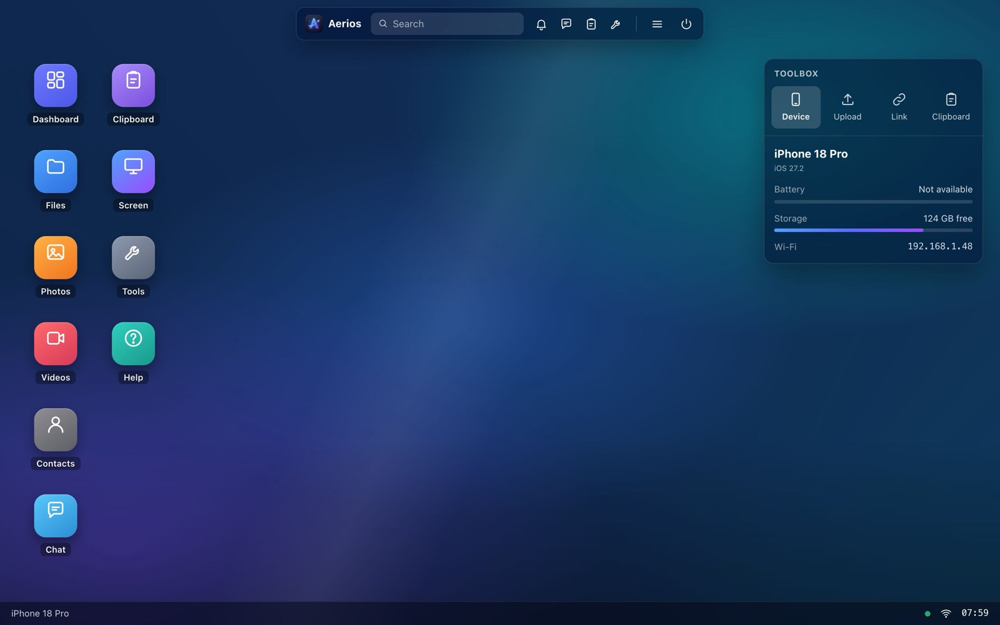
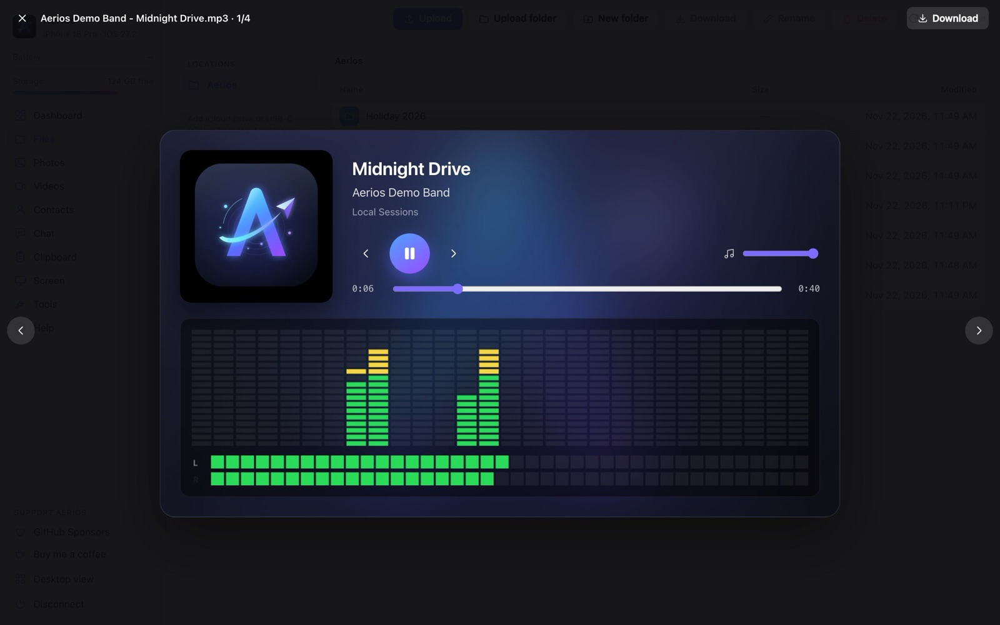

  

<h1 align="center">Aerios</h1>

  Your iPhone, iPad or Android phone on your computer: files, photos, music, contacts, chat, clipboard, screen and more. 
  100% local, no account, no ads · Mac, Windows, Linux · English, Italiano, Deutsch, Français, Español

<a href="https://github.com/kikoz85/Aerios/releases/latest"><b>⬇ Download the desktop app</b></a>

## Download

Get the latest version from **[Releases](https://github.com/kikoz85/Aerios/releases/latest)**:

| System | File |
|---|---|
| macOS 11+ (Apple Silicon and Intel) | `Aerios-<version>-macos.dmg` — signed and notarized by Apple |
| Windows 10/11 x64 | `Aerios_<version>_x64-setup.exe` |
| Windows 11 on ARM | `Aerios_<version>_arm64-setup.exe` |
| Linux x64 | `.deb` (Debian, Ubuntu), `.rpm` (Fedora, openSUSE) or `.AppImage` |
| Linux ARM64 | `_arm64.deb`, `.aarch64.rpm` or `_aarch64.AppImage` |

The app updates itself: it checks for new versions, downloads them in the background, verifies their signature and
installs them when you quit (Settings › *Check for updates* to do it now). `SHA256SUMS.txt` lists the checksums.

You also need the **Aerios app on your phone or tablet** (iPhone/iPad and Android), on the same Wi-Fi network: the
desktop app finds it by itself. Nothing passes through the internet.

| | |
|---|---|
|  |  |
| Settings: clipboard sync, phone notifications, automatic updates | Music with cover art, LED spectrum and VU meter |

## Italiano

Il tuo iPhone, iPad o telefono Android sul computer: file, foto, musica, contatti, chat, appunti, schermo e altro.
Tutto in locale, senza account né pubblicità. Scarica l'app per **Mac, Windows o Linux** dalle
**[Release](https://github.com/kikoz85/Aerios/releases/latest)** (stessa tabella qui sopra): si aggiorna da sola.
Serve anche l'**app Aerios sul telefono o tablet**, sulla stessa rete Wi-Fi.

## Support

Aerios is free. If it's useful to you, you can support its development:
[GitHub Sponsors](https://github.com/sponsors/kikoz85) · [PayPal](https://www.paypal.com/donate/?hosted_button_id=B9PE789NMSURW) ·
[enricofanucchi.com](https://www.enricofanucchi.com)

© Enrico Fanucchi
